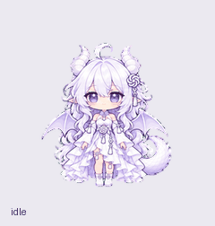
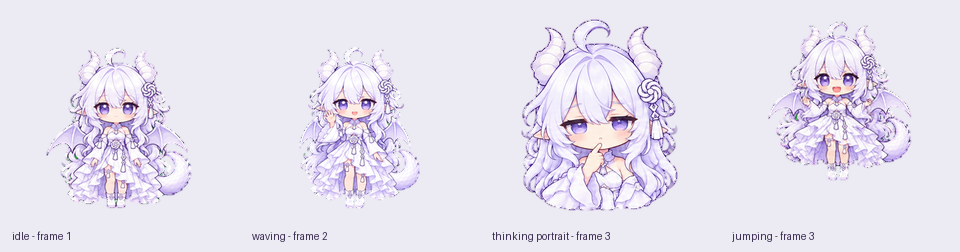

# GPT白龙娘

银白长发、紫瞳、白色弯角、浅紫龙翼与卷尾的 GPT 龙娘 Pets 素材。

本仓库收录已完成并通过校验的 **Pets v2 精灵图、9 种状态动画和 16 方向视线**。
角色形象及动作设计参考 [bailong-desktop-pet](https://github.com/EntropyTea/bailong-desktop-pet)。

## 动画预览

### 2026-11-01：大头思考动画

本版为 Pets 精灵图第 7 行 `running`（处理／思考）状态提供龙娘大头像，包含托腮、轻微抬眼、歪头与眨眼的六帧循环。


[原尺寸大头动画](previews/thinking.gif) · [24 像素图标预览](previews/chat-status-24px.gif) · [四帧静图](docs/thinking-stills.png)

本次仅替换第 7 行 `running` 的六帧；其余 67 帧保持相同像素。参见[像素保留证明](qa/pixel-preservation.json)、[头像视觉检查](qa/portrait-visual-review.json)和[保存结果核验](qa/stored-verification.json)。视线方向及盲检结果沿用已验证的相同帧。

当前使用的 Pets 插件更新接口通过一张精灵图替换宠物动画，未提供分别设置桌面宠物与对话状态图标资源的字段。本仓库提供 `running` 的头像版和独立导出的头像预览；各客户端是否、何时将该状态用于对话图标，由客户端实现决定。

### 完整动画



[MP4 完整预览](previews/all-states.mp4) · [待机—跳跃—待机](previews/idle-jump-idle.gif) · [视线循环](previews/look-loop.gif)



## 素材规格

- 精灵图：[assets/spritesheet-v2.png](assets/spritesheet-v2.png)，透明 PNG，1536 × 2288。
- 网格：8 列 × 11 行；单元格 192 × 208。
- 有效帧：73；其余 15 个单元格完全透明。
- [pet.json](pet.json) 记录素材布局、各状态帧数及播放时长。
- 招手与等待回应中包含开合嘴的对话效果；`running` 表示专注思考与处理任务。

| 行 | 状态 | 动作 | 帧数 |
| --- | --- | --- | ---: |
| 0 | `idle` | 待机 | 6 |
| 1 | `running-right` | 向右移动 | 8 |
| 2 | `running-left` | 向左移动 | 8 |
| 3 | `waving` | 招手回应 | 4 |
| 4 | `jumping` | 跳跃 | 5 |
| 5 | `failed` | 失落 | 8 |
| 6 | `waiting` | 等待回应 | 6 |
| 7 | `running` | 大头思考 | 6 |
| 8 | `review` | 检查结果 | 6 |
| 9–10 | look | 从上方开始顺时针排列的 16 方向视线 | 16 |

每种状态的 GIF 位于 [previews/states](previews/states)。

## 图集与检查

- [全帧联系表](docs/contact-sheet.png)
- [带标签的视线方向表](docs/direction-sheet.png)
- [结构检查](qa/structure.json)、[综合质量检查](qa/quality.json)、[连续性检查](qa/continuity.json)
- [方向语义记录](qa/direction-semantics.json)、[独立方向盲检结果](qa/blind-validation.json)
- [Pets 官方预检](qa/pets-preflight.json)

最终精灵图 SHA-256：

```text
a3a290ad5f10efc1718c045a0231f6209547ebd5f0bfb0b324c31479b782eecb
```

本仓库中的精灵图采用 Pets v2 固定规格；预览文件保留相应的关键帧播放节奏。
